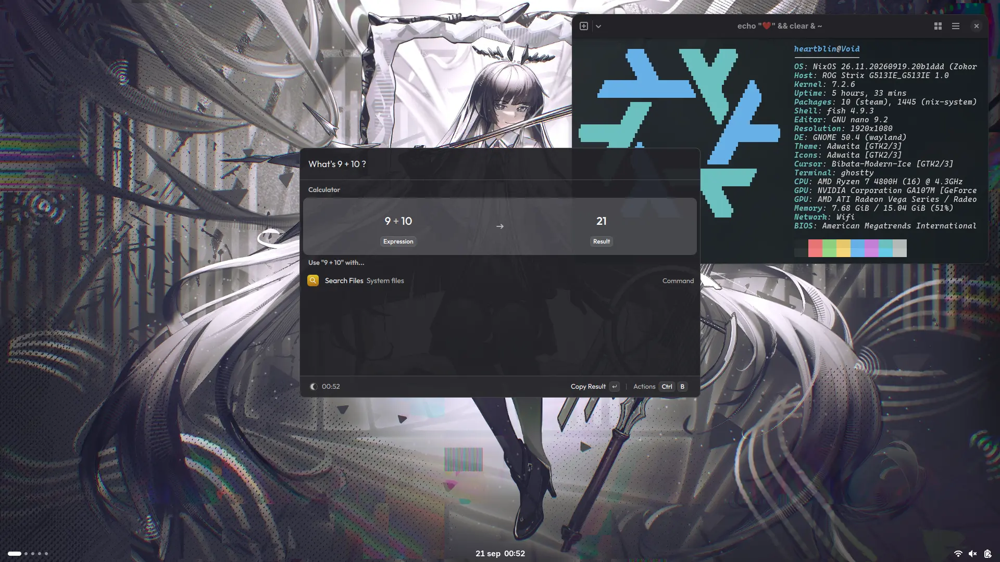

### `Stygian`

 
This is my repo for keeping my NixOS flake in. Inspired by:

  <a href="https://github.com/TheMaxMur/NixOS-Configuration">TheMaxMur</a>
  •
  <a href="https://github.com/rxyhn/yuki">rxyhn</a>
  •
  <a href="https://gitlab.com/fazzi/nixohess">fazzi</a>
  •
  <a href="https://github.com/NotAShelf/nyx">NotAShelf <i>archived</i></a>

### Hosts
- [`Reason`](hosts/Reason) - Server built out of whatever components. [`Specs`](docs/rSpecs.md)!
- [`Void`](hosts/Void) - ROG Strix G513 laptop, with some issues. [`Specs`](docs/vSpecs.md)!

### Preview

_Screenshot taken on: <b>2026-09-21</b>_

### Disclaimer

> [!CAUTION]
> This repo is to be considered unstable.
> Nothing here is going to be ever finalised.
>
> For others, this means anything in [`packages`](packages/) and
> [`modules`](modules/) can just disappear in one commit.
> The structure of the flake itself can also change radically.
>
> This repo is really only intended for me. Bearing in mind that, please,
> check on upstream resources before copying one of my modules, or look for
> better suited ways to do things for yourself. This is public as a
> reference for others, as I believe showing a way out of the hundreds of
> other ways to manage and maintain a NixOS multi-host flake.

### Contributing

I genuinely doubt anyone will, but, if you spot some dumb shit here, please feel free to roast me in a PR.

After all, it is open source, no?
